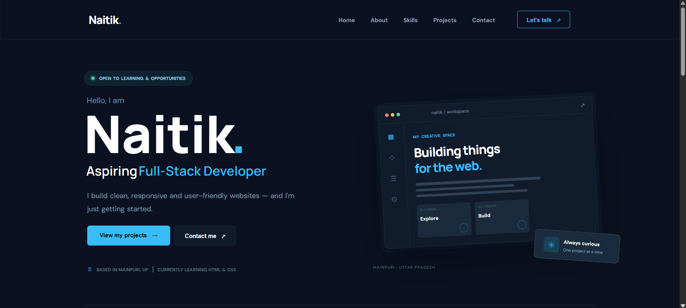

# Naitik — Personal Portfolio


A responsive personal portfolio built from scratch with **HTML5** and **CSS3**, showcasing my skills, projects, and learning journey as an aspiring full-stack developer.


---

## 📸 Preview



---

## ✨ Features

- **Responsive design** that adapts to mobile (up to 600px), tablet (768px to 1024px), and desktop screens
- **Sticky navigation header** that stays visible while scrolling
- **Hero section** with a styled workspace mockup and a floating info card
- **About section** with a two-column layout and key facts (location, learning, goal)
- **Skills section** with status badges: *Completed*, *Currently learning*, *Learning next*, and *Coming soon*
- **Projects section** with browser-style preview cards, tech tags, and links
- **Learning journey timeline** showing my progress so far
- **Contact section** with a two-column layout (contact details and a message form)
- **Responsive footer** with grid-based link columns
- **Dark, developer-focused theme** built with CSS custom properties (variables)

---

## 🛠️ Built With

| Technology | Used For |
|---|---|
| **HTML5** | Semantic page structure (`header`, `section`, `footer`, `nav`) |
| **CSS3** | Layout, styling, animations, and responsiveness |
| **Flexbox** | Navigation, hero section, and card alignment |
| **CSS Grid** | Skills, projects, about, and contact layouts |
| **Media Queries** | Responsive breakpoints for mobile and tablet |
| **CSS Variables** | Consistent colors and theme values |
| **Position: Sticky** | Keeping the header visible on scroll |
| **Google Fonts** | DM Sans and Manrope typography |
| **Devicons (CDN)** | Technology icons in the skills section |
| **Git & GitHub Pages** | Version control and free hosting |

---

## 📂 Project Structure

```text
Personal-Portfolio-Landing-Page/
├── assets/
│   └── images/
│       ├── netflix.png        # Preview image for the Netflix clone card
│       └── portfolio.png      # Preview image for this portfolio card
├── .gitignore                 # Files Git should ignore
├── index.html                 # Page structure and content
├── style.css                  # All styling and responsive rules
└── README.md                  # Project documentation
```

---

## 🚀 Getting Started

### Option 1: Open directly in the browser

```bash
git clone https://github.com/naitik595/Personal-Portfolio-Landing-Page.git
cd Personal-Portfolio-Landing-Page
```

Then open `index.html` in any modern browser.

### Option 2: Run with Live Server (recommended)

1. Open the folder in **VS Code**
2. Install the **Live Server** extension
3. Right-click `index.html` and select **Open with Live Server**

---

## 🧠 What I Learned

- Structuring a multi-section page with **semantic HTML**
- Building responsive layouts with **Flexbox** and **CSS Grid**
- Writing **media queries** for tablet and mobile breakpoints
- Using **CSS variables** to keep colors consistent across the site
- Creating hover states and **transitions** for interactive elements
- Debugging layout issues such as the **box model**, **stacking context** (`z-index`), and **sticky positioning**
- Deploying a static site with **GitHub Pages**

---

## 🗺️ Roadmap

- [x] Hero, About, Skills, Projects, and Contact sections
- [x] Responsive layout for mobile, tablet, and desktop
- [x] Deployment on GitHub Pages
- [ ] Connect the contact form to a real backend or form service
- [ ] Add a learning journey timeline
- [ ] Add a Restaurant landing page project
- [ ] Learn JavaScript and add interactive features (mobile menu, form validation)

---

## 📬 Contact

- **Email:** [naitik04560@gmail.com](mailto:naitik04560@gmail.com)
- **GitHub:** [@naitik595](https://github.com/naitik595)
- **LinkedIn:** [Naitik Rajput](https://www.linkedin.com/)

---

## 📄 License

This project is for personal and educational purposes. Feel free to read the code and learn from it, but please do not copy the design as your own work.

---

<div align="center">

**Built with curiosity, one project at a time.** ⭐ If you found this helpful, consider starring the repository.

</div>
